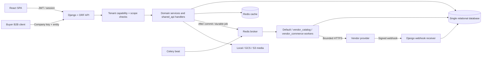

# Implemented architecture

Inspected 2026-11-19. This document describes source structure; it introduces no
new platform architecture policy. [ADR-0002](../../architecture/decisions/ADR-0002-single-source-of-truth-architecture-docs.md)
keeps architectural decisions in `architecture/`.

## Request lifecycle and ownership

1. `frontend/src/main.tsx` mounts App; App installs theme/query/snackbar providers,
   initializes auth and resolves SPA routes. `apiClient.ts` adds access tokens,
   serializes concurrent refreshes and retries a request once after a 401.
2. `backend/config/urls.py` composes active `/api/v1/` routes. Some app `urls.py`
   files contain empty routers and are unused. API inventories follow the actual
   resolver rather than directory names or stored `schema.yml`.
3. DRF defaults authenticate session, company API key, then JWT; permissions default
   to IsAuthenticated, unless a view/action overrides them. The plain Django
   webhook receiver implements its own HMAC/signature checks.
4. `CheckAccessMixin` maps actions to `tenant.services.check_access`; queryset and
   service guards supply tenant/entity/resource isolation. Many handlers have
   additional checks. Middleware only attaches lazy buyer scope to requests that
   are already authenticated; it does not enforce all the gates in its docstring.
5. Serializers, model clean/save hooks and services validate inputs, record evidence
   and update state. DRF exceptions use `config/exceptions.py`; explicit action
   Responses and plain Django errors have different payload shapes.
6. Background work uses direct Python imports, `.delay()` or explicit Celery
   `send_task`; there is no verified universal event bus. Some event intents only
   log, while portfolio changes call projection recalculation directly.

One database contains all tenants; there is no per-tenant schema or verified
database row-level security. UUID scope columns and application queries enforce
isolation. Numerous cross-context UUID references are deliberately not ORM foreign
keys; they require service validation. Read [database invariants](DATABASE_SCHEMA.md).

## Important flows

- **Device to buyer catalog:** portfolio service validates company/entity and
  device lifecycle → records portfolio snapshot/change → refreshes projections
  for affected users → catalog reads recheck current device/product/media/source/
  regional eligibility. Portfolios are shared within company/entity; projections
  retain per-user keys. Empty portfolio is a valid state.
- **Supplier catalog:** admin configures approved vendor/brand and mapping → sync
  row commits → dedicated queue processes bounded pages → durable raw source
  item plus review errors → canonical Product adapter and compatibility commands
  → deferred image processing. Invalid observations do not authorize overwriting
  approved canonical truth. Source/provider systems are consumed read-only.
- **Export to order:** frozen export selections and versioned BuyerExportMapping
  bind company/entity/storefront, supplier and pricing snapshot → order acceptance
  resolves those selections → immutable AcceptedOrderLine → supplier suborders →
  durable dispatch → external response evidence. Never route by a global SKU alone.
- **Fulfillment/returns:** vendor shipping CSV, status poll, signed webhook or
  carrier observation resolves vendor-scoped handoff → evidence/status updates →
  buyer update signals/SLA evaluation. Returns retain their own lifecycle/import log.
- **PO and invoices:** nested PO create computes frozen prices/totals; approval
  invokes the older orchestration path. That path includes synthetic delivery
  confirmation and other defects; it must not be assumed equivalent to supplier
  dispatch. Invoice creation uses explicit run/period/line transactions and
  transition tables; see module guide and known issues before financial changes.

## Authentication and security boundaries

Custom user model `tenant.User` uses email login and entity membership. Capabilities
are atoms, with company defaults, memberships/delegations and system-admin paths.
Role labels are not sufficient authority. Buyer/vendor fallback capability branches
are real implementation and need special review (ISSUE-005).

Company API keys resolve an active external company and an authorized active user
in an explicitly selected entity when multiple entities are available; they do not
reassign users. Key storage/exposure needs review. Vendor credentials use a separate
MultiFernet key ring. Transport validates public HTTPS targets, pins DNS, bounds
responses and refuses unsafe headers/redirect behavior. Preserve these controls
across all new provider operations. See [issues](KNOWN_ISSUES.md).

## Processing, caching and deployment

`config/settings.py` schedules catalog dispatch (60s), SLA evaluation/manual exports
(900s), buyer signals/shipment poll dispatch (300s), device/product lifecycle and
finance dispatch (3600s), carrier tracking (1800s), outbound retry (120s).
Production worker subscribes to `celery,vendor_catalog,vendor_commerce`; beat uses
DatabaseScheduler. Definitions do not prove workers/beat are running or scheduled
tasks are effective in a deployed environment.

Redis cache wrappers hold companies/category mappings for 300s and dropdowns/
capabilities for 600s; signals refresh some entries. Bulk ORM writes bypass signals,
so inspect cache invalidation when changing ingestion. SQLite/local test variants
replace Redis and run ordinary tasks eagerly; explicit `send_task` still queues.

Backend Docker image runs Python 3.12; production Compose runs Gunicorn, Redis,
Celery and beat against an externally configured database. Frontend image builds
with Node 20 then serves the SPA from Nginx. Proxy/TLS routing is environment-specific,
not proven by this repository. Local-copy Compose uses PostgreSQL 18 and is distinct
from the dev PostgreSQL 16 stack. Never start restored production periodic jobs
without reviewing their target and provider effects.
