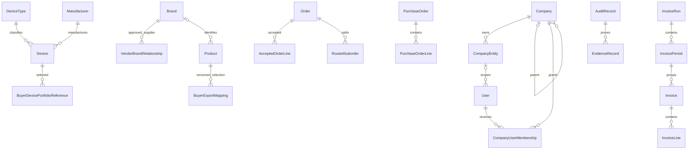

# Database schema and consistency

Verified from loaded Django model definitions on 2026-11-19, using test settings
and a SQL-blocking inventory. **124 owned models + 7 automatic M2M join models,
1,608 local fields, 112 owned migration files.** Framework auth/admin/session,
Celery beat/results and content-type tables are managed by their installed apps;
they are outside the owned model inventory. No deployed database schema or records
were inspected. Runtime schema, applied migrations and data quality remain unverified.

## Complete field and migration reference

Each link contains every model's table, fields/columns, Django types, length/
precision/scale, PK, nullability, blank policy, defaults (callables not evaluated),
choices, FK deletion behavior, M2M through tables, indexes, unique constraints,
ordering and exact migration file paths. Defaults on credential-like fields are
redacted. Physical SQL types depend on the selected database backend; these are
Django definitions, not a PostgreSQL schema dump.

| App | Reference | Important ownership |
|---|---|---|
| tenant | [schema](reference/schema/tenant.md) | Company/entity hierarchy, custom users, capabilities, memberships, invitations, regions/DCs |
| audit | [schema](reference/schema/audit.md) | Audit→evidence→amendment/supersession/file chain |
| notification | [schema](reference/schema/notification.md) | Templates, preferences, requests/attempts, in-app items and reminder chains |
| media | [schema](reference/schema/media.md) | Asset versions/renditions/upload sessions; owner IDs are references |
| devices | [schema](reference/schema/devices.md) | Device types/manufacturers/features/capability evidence and portfolio history |
| catalog | [schema](reference/schema/catalog.md) | Supplier products/brands, governed rules, assertions, universal scopes, projections, exports/mappings |
| pricing | [schema](reference/schema/pricing.md) | Profiles, effective/shipping snapshots, MAP exceptions and commission agreements |
| routing | [schema](reference/schema/routing.md) | Orders, immutable accepted lines, supplier suborders, export windows/attempt/evidence/logs |
| fulfillment | [schema](reference/schema/fulfillment.md) | Handoffs, delivery/SLA evidence, buyer signals, returns and import logs |
| invoicing | [schema](reference/schema/invoicing.md) | Runs→periods→invoices→lines/adjustments and reconciliation exceptions |
| integration | [schema](reference/schema/integration.md) | Connections/keys/storefronts, source items, sync budgets/runs, commerce dispatch/receipt/finance records |
| analytics | [schema](reference/schema/analytics.md) | Reporting metrics, windows, immutable aggregations and freshness markers |
| procurement | [schema](reference/schema/procurement.md) | PurchaseOrder→PurchaseOrderLine with frozen unit/MSRP totals |
| launch | [schema](reference/schema/launch.md) | Coordination event with source readiness references |

The diagram shows selected **actual ORM relations** only. Product/company/vendor
scope, pricing references, handoff/suborder, portfolio snapshot IDs and many event
triads are UUID values without database FK enforcement. Read the field reference
before treating an ID as a referential constraint.

## Transactions and invariants

- Tenant root and entity scope travel together; a user ID alone is not a tenant.
  Company.clean restricts hierarchy to two levels and MAP enforcement to vendors;
  Company.save invokes full_clean and creates an HQ entity for a new company.
- Portfolio mutation creates reference/snapshot/change evidence and projection
  changes in atomic blocks. Snapshots freeze facts; current portfolio reads are
  shared within company/entity, while projection uniqueness includes a user.
- Product SKU uniqueness is scoped to vendor; ambiguous global SKU lookups cannot
  choose a supplier. Approved vendor/brand and source review/listing gates constrain
  buyer visibility. Category/value configuration is governed data, not free-form truth.
- `offer_services.freeze_export_selection` locks storefront/entity and product,
  increments mapping version, supersedes current selection and freezes supplier/
  pricing. Listing uniqueness is conditional on active mapping scope; nullable legacy
  storefront paths need separate review. Accepted lines retain selected mapping facts.
- Vendor catalog sync reserves budget under locks; active-run and source-item
  uniqueness and configuration versions constrain replay. Queue publication occurs
  after commit for durable work. Lost queue publication must remain recoverable.
- Pricing/evidence snapshots and issued financial history have model-level
  immutability guards. These are **not database triggers**: bulk update/delete and
  direct SQL can bypass save hooks. Audit creation guards also contain known defects.
- PO nested create and invoice generation contain atomic blocks; older PO approve
  + orchestration has no encompassing transaction. Do not assume partial-failure
  rollback or external delivery confirmation (ISSUE-003).
- Signed webhook receipts deduplicate by profile/provider event. Imports preserve
  history; invalid provider data requires review rather than guessing missing truth.

Migration consistency dry run on 2026-11-19 returned nonzero for two generated
integration index-name differences (ISSUE-010). No migration file was generated,
and no application database was migrated. Applied migration state must be checked
separately in an authorized target before any schema work.
