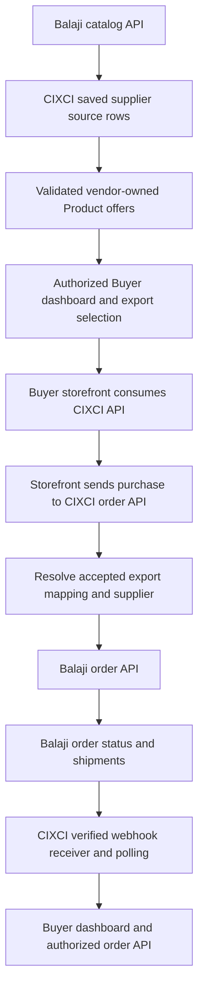

# Balaji catalog, Buyer orders and fulfillment integration

Reviewed: 12 November 2026. This is a verified contract/gap analysis and rollout
plan, not a claim that the complete flow is implemented or released.

Authorities:
- [Balaji Customer API](https://www.balajiwireless.com/integrations/api), refreshed
  successfully over HTTPS during this review.
- [CIXCI Supplier Routing Requirements v1.2](CIXCI_Accessory_Vendor_Configuration_and_Supplier_Routing_Requirements.docx).
- [Buyer Pricing Mode guide](CIXCI_Buyer_Pricing_Mode_Developer_Guide_v1.0.docx).

## Intended flow

Dashboard and API must share eligibility, tenant/Entity authorization and Pricing
rules. Imported does not mean published to every Buyer. The Buyer website must
send its purchase back to CIXCI; exporting a Product does not itself notify CIXCI
of a later sale. Keep the company-wise Buyer API key and authorized Entity scope.
Supplier credentials belong to the supplying Vendor connection, not that key.

## Provider capabilities and implementation status

All provider paths below are relative to https://shop.balajibrands.com.

| Flow step | Balaji contract | Current CIXCI status |
| --- | --- | --- |
| Full/incremental catalog | GET /api/v1/catalog, cursor, stock, prices, next_arrival_date | Saved full manual/weekly catalog ingestion implemented; required canonical setup still blocks current rows |
| Selected item lookup | GET /api/v1/items with SKU/UPC; separate allowance | Not integrated into order-time revalidation |
| Buyer dashboard/export/API | CIXCI-owned responsibility | Existing dashboard/export/read API; stable supplier/storefront export mapping still required |
| Receive storefront order | CIXCI-owned responsibility | Existing /api/v1/routing/orders/ needs mapping-based resolution and correct authorized Entity; legacy first SKU/UPC/Entity resolution remains |
| Submit supplier purchase | POST /api/v1/orders, orders:write | Provider-specific outbound order adapter not implemented |
| Observe acceptance/failure | GET /api/v1/orders and /api/v1/orders/{po_number}, orders:read | Read probes verified; durable adapter/status reconciliation not implemented |
| Address/store routing | GET /api/v1/ship-tos; PUT /api/v1/ship-to-map; optionally ship_to.address | Read probe verified; onboarding choice/permission must be explicit |
| Shipping/tracking | GET /api/v1/shipments, shipments:read | Read probe verified; automatic provider reconciliation not implemented |
| Events | POST /api/v1/webhooks, webhooks:manage; order/shipments/stock events | Balaji registration, signature verification and provider event processing not implemented |
| Buyer tracking presentation | Existing CIXCI fulfillment/dashboard/API | Existing fields/import paths; end-to-end provider updates and consolidated parent release still required |

The existing catalog transport deliberately performs bounded GET requests. It is
not an order-submission transport. A configurable catalog URL alone does not
enable outbound orders or event handling. Future Vendors need explicitly
supported capabilities and verified provider contracts; do not claim arbitrary
protocols/order behavior work through Product field mapping alone.

## Verified provider constraints

- A credential reads its Balaji account and sub-accounts. Test keys validate
  orders without placing them; dry_run=true also avoids saving an order.
- Live ordering requires Balaji account enablement and orders:write permission.
  Acceptance may be pending_release or held, and is not evidence of shipment.
- A stable po_number identifies the supplier request across retries. Reuse it
  after timeouts; preserve supplier-specific external IDs and original request
  evidence. Handle price flags, stock/credit failures and partial fulfillment.
- Order/shipment reads are documented on a 15-minute cadence, with cursor paging
  and 30-minute incremental overlap. Deduplicate by provider identity and retain
  the last successful watermark only after complete paging.
- Webhooks require raw-body HMAC-SHA256 verification, timestamp tolerance,
  constant-time signature comparison and stable event-ID deduplication. Test
  endpoints receive test events; a public HTTPS receiver is required.
- Direct consumer shipping needs explicit Balaji drop-ship enablement and US
  address validation. An account with a store map requires store_id. Do not
  silently replace the account's store map or assume drop-ship is enabled.
- next_arrival_date is a restock estimate, not a customer's delivery date. The
  documented shipment schema provides ship_date, tracking, carrier/link and
  carrier_status, but no guaranteed delivery-ETA field. Missing ETA stays unknown
  until an authoritative provider/carrier contract supplies it.
- The documented shipment response also does not establish per-package covered
  line quantities. CIXCI's split-shipment completeness rule needs authoritative
  line/quantity evidence; do not infer it from a Shipped label or one tracking ID.

## Evidence from this session

Local diagnosis found 1,791 source rows and zero linked Products for the saved
Balaji-backed Local QA Vendor connection. Launch Date, MSRP, category mapping,
Brand approvals and canonical media are unresolved. Catalog and item read
schemas do not document the missing MSRP/launch facts; order/shipment APIs do
not supply a valid replacement. See [catalog visibility diagnosis](vendor-catalog-import-visibility.md).

Using the saved authorized test credential, GET orders, GET shipments and GET
ship-tos each returned HTTP 200/success with empty lists. This proves endpoint
read access only; no existing order, parcel, ship-to or delivery ETA was proven.
Zero remote writes were made: no order placed, no webhook registered, no address
or store map changed. A local audit records the read-only probes without secrets
or customer addresses. Private evidence: balaji-fulfillment-read-proof.log.

## Sequential rollout and release checks

1. Resolve required Product enrichment and real Vendor onboarding. Keep source
   review visible and preserve required validation. Neither date nor MSRP can be
   fabricated from update timestamps, wholesale prices or product titles.
2. Implement EXP-01/02/03 export mappings scoped to Buyer Entity and integration/
   storefront. Persist Product ID, supplier ID, listing reference/version and
   frozen pricing evidence. Migrate only authoritative historical matches.
3. Implement ORD-01/02/03 inbound mapping resolution before any order write or
   handoff. Reject missing, foreign, ambiguous or mismatched references. Keep
   duplicate purchase/retry handling atomic and accepted supplier immutable.
4. Add a versioned Balaji order capability/adapter: exact ship-to configuration,
   stable supplier PO, durable outbox, request/response audit, asynchronous
   acceptance/holds/failure handling. Prove with fixtures and authorized test-key
   dry runs before any live dispatch enablement.
5. Add signed webhook intake plus 15-minute polling reconciliation, duplicate/
   out-of-order handling, secret rotation, recovery and bounded shared budgets.
   Retain every shipment/tracking number and provider status without guessing ETA.
6. Complete SHP-01 through SHP-05: authoritative package/line quantities, partial
   and split shipments, authorized cancellation accounting, parent completeness,
   one deduplicated consolidated Buyer update and Operations pending-detail UI.
7. Prove the full scenario through Buyer dashboard and the same company-wise API,
   including two suppliers with the same SKU, multiple Entities/storefronts,
   changed mappings, retries/timeouts, rejected/held orders, duplicate webhooks,
   multiple tracking numbers and missing ETA. Commission follows the Pricing
   guide and accepted snapshots, never a guessed importer fallback.

## Unresolved inputs before dependent implementation

Verified required Product data; actual production Vendor/Brand approvals;
Balaji drop-ship versus saved-store configuration; enabled production key scopes;
authoritative delivery ETA and package line-quantity contract. Preserve existing
Telco products/API behavior while resolving these. Catalog ingestion and a review
UI do not constitute completed fulfillment integration. No Vendor work is pushed
or deployed by this analysis.
